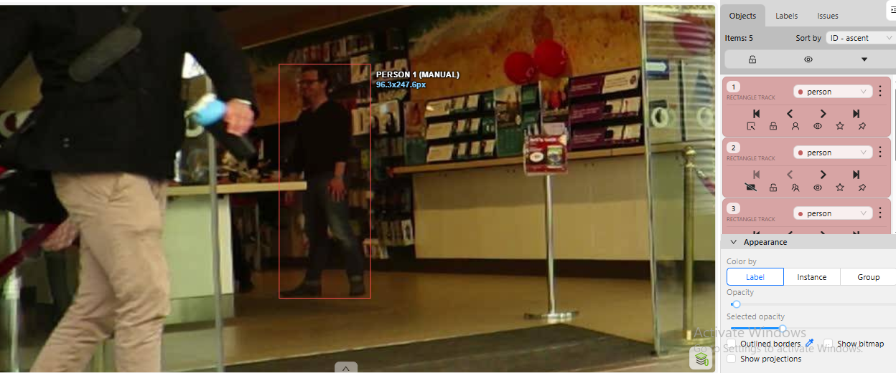
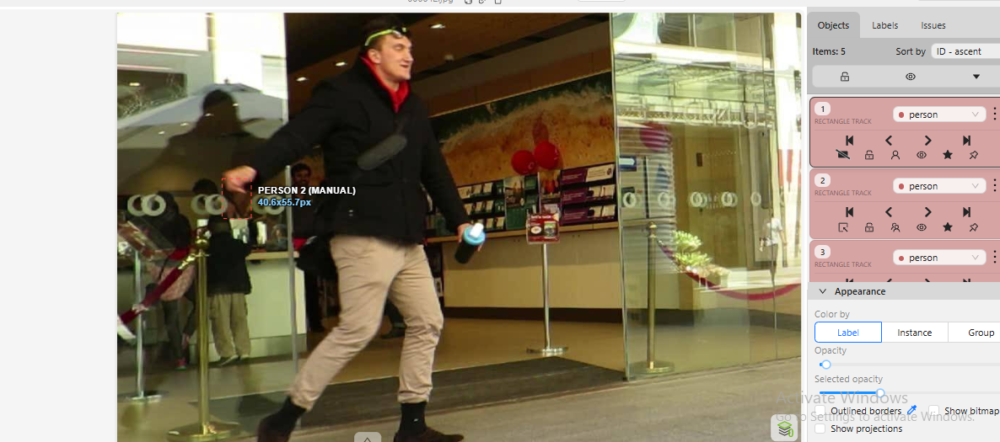
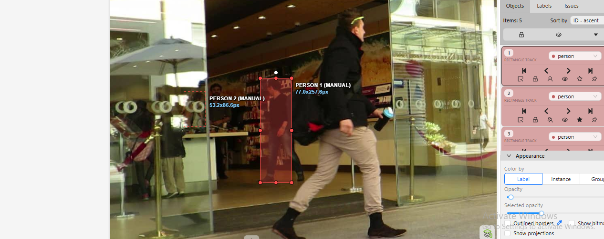

# Báo cáo cá nhân — PhamManhHung-2A202603240

Đổi tên file theo quy tắc `MSSV_HoTen.md`. Ví dụ: `20241234_NguyenVanAn.md`.

Đoạn video: MOT17-09, 150 frame (frame 1–150), nguồn MOTChallenge, giấy phép CC BY-NC-SA 3.0.

## 0. Thông tin học viên

- Họ tên: Phạm Mạnh Hùng
- MSSV: 2A202603240
- Mã đề (A/B/C): Điền A
- Email: 26ai.hungpm@vinuni.edu.vn
- Link repository: https://github.com/Hungdzb0doi/K5-L2-Day05-PhamManhHung-2A202603240-MOTTracking.git
- Giờ bắt đầu: [Điền giờ bắt đầu, ví dụ: 17:30]
- Giờ kết thúc: [Điền giờ kết thúc, ví dụ: 19:00]

## 1. Xem trước đoạn video (CP0)

Ghi **trước khi vẽ**, mỗi người một dòng.

| Mã | Frame xuất hiện | Frame cuối thấy được | Rẽ / dừng / đổi tốc độ ở frame | Bị che ở frame | Ghi chú |
|---|---|---|---|---|---|
| P1 (MOT Track 1 / CVAT Track 0) | 0 | 149 | Đổi nhịp bước ở các đoạn frame 3–7, 16–36, 77, 101–104, 143–149 | Khuất hẳn (`outside`) từ frame 41–48 | Có mặt tổng cộng 142 frame; đi khuất trong 8 frame rồi xuất hiện lại ở frame 49 |
| P2 (MOT Track 2 / CVAT Track 3) | 0 | 146 | Thay đổi hướng/tốc độ ở đoạn đầu 0–43, các frame 97, 104–105 và 136–143 | Bị che một phần (`occluded`) 16 frame; khuất hẳn (`outside`) từ 110–135 | Có mặt 121 frame; sau frame 146 đối tượng đi hẳn ra khỏi rìa khung hình |
| P3 (MOT Track 3 / CVAT Track 2) | 1 | 149 | Đi bộ liên tục từ frame 1–149, kích thước box thay đổi dần theo khoảng cách tới camera | Không bị che (0 frame `occluded`, 0 frame `outside`) | Có mặt 149 frame liên tục, nhìn thấy rõ trong suốt đoạn video |
| P4 (MOT Track 4 / CVAT Track 4) | 1 | 149 | Thay đổi vị trí và kích thước liên tục ở các cụm frame 1–25, 27–48, 51–87, 91–149 | Bị che một phần (`occluded`) tổng cộng 66 frame nhưng không lúc nào mất hẳn | Có mặt 149 frame; đi qua vùng đông người nên bị che khuất một phần trong thời gian dài |
| P5 (MOT Track 5 / CVAT Track 1) | 39 | 149 | Bước vào khung hình từ frame 39, đổi nhịp di chuyển ở các đoạn 47–61, 64–89, 91–114, 121–149 | Bị che một phần (`occluded`) tổng cộng 63 frame, không bị mất hẳn | Xuất hiện muộn từ frame 39 (có mặt 111 frame); bị người khác che một phần trên đường đi |

## 2. Keyframe và thời gian (CP1, CP4)

Số keyframe lấy từ kết quả `src/check_submission.py`.

| Mã | Số keyframe | Keyframe ở frame | Số frame có mặt | Keyframe / 100 frame | Thời gian (phút) | Chỗ khó |
|---|---|---|---|---|---|---|
| P1 (CVAT Track 0) | 24 | 0, 1, 3, 4, 5, 6, 7, 16, 19, 28, 34, 35, 36, 49, 77, 101, 104, 143, 144, 145, 146, 147, 148, 149 | 142 | 16.9 | 10 | Căn chỉnh keyframe ngay trước khi khuất (frame 36–41) và lúc vừa hiện lại (frame 49) |
| P2 (CVAT Track 3) | 52 | 0, 1, 2, 3, 4, 5, 6, 7, 8, 9, 10, 11, 12, 13, 14, 15, 16, 17, 18, 19, 20, 21, 22, 23, 24, 25, 26, 27, 28, 29, 30, 31, 32, 33, 34, 35, 36, 37, 38, 39, 40, 43, 97, 104, 105, 136, 137, 138, 140, 141, 142, 143 | 121 | 43.0 | 12 | Xử lý kết hợp cả cờ `occluded` (16 frame), cờ `outside` khi khuất giữa chừng (110–135) và lúc rời khung hình (sau frame 146) |
| P3 (CVAT Track 2) | 139 | 1, 2, 3, 4, 6, 7, 9, 10, 11, 12, 13, 14, 16, 17, 18, 19, 20, 21, 22, 23, 24, 25, 27, 28, 29, 31, 32, 34, 35, 36, 37, 39, 40, 41, 42, 43, 44, 45, 46, 47, 48, 49, 50, 51, 52, 53, 54, 55, 56, 57, 58, 59, 60, 61, 62, 63, 64, 65, 66, 67, 68, 69, 71, 72, 73, 74, 75, 76, 77, 78, 79, 80, 81, 82, 83, 84, 85, 86, 87, 88, 89, 90, 91, 92, 94, 95, 96, 97, 98, 99, 100, 102, 103, 104, 105, 106, 107, 108, 109, 110, 111, 112, 113, 114, 115, 116, 117, 118, 119, 120, 121, 122, 123, 124, 125, 126, 127, 128, 129, 130, 131, 132, 133, 134, 135, 136, 137, 138, 139, 140, 141, 142, 143, 144, 145, 146, 147, 148, 149 | 149 | 93.3 | 15 | Nhịp vung tay chân khi đi bộ làm biên người thay đổi nhẹ liên tục, dẫn tới việc chỉnh tay gần như từng frame |
| P4 (CVAT Track 4) | 132 | 1, 2, 3, 4, 5, 6, 8, 9, 10, 11, 12, 13, 14, 15, 16, 17, 18, 19, 20, 21, 22, 23, 24, 25, 27, 28, 29, 31, 32, 33, 34, 35, 37, 38, 39, 40, 41, 42, 44, 45, 46, 47, 48, 51, 54, 57, 58, 61, 62, 63, 64, 66, 67, 68, 69, 70, 71, 72, 73, 74, 75, 76, 77, 78, 79, 80, 81, 82, 83, 84, 85, 86, 87, 91, 92, 93, 94, 95, 96, 97, 98, 99, 100, 101, 102, 103, 104, 105, 106, 107, 108, 109, 110, 111, 112, 113, 114, 115, 116, 117, 118, 119, 120, 121, 122, 123, 124, 125, 126, 127, 128, 129, 130, 131, 132, 133, 134, 135, 136, 137, 138, 139, 140, 141, 142, 143, 144, 145, 146, 147, 148, 149 | 149 | 88.6 | 15 | Bị che khuất một phần kéo dài (66 frame), khó ước lượng vị trí bàn chân bị khuất (nhất là ở frame 4) |
| P5 (CVAT Track 1) | 92 | 39, 40, 41, 47, 48, 49, 50, 51, 52, 53, 54, 55, 56, 57, 58, 59, 60, 61, 64, 65, 66, 67, 68, 70, 71, 72, 73, 74, 75, 76, 77, 78, 79, 80, 81, 82, 83, 84, 85, 86, 87, 88, 89, 91, 92, 93, 94, 95, 96, 97, 98, 100, 101, 102, 103, 104, 105, 106, 107, 109, 110, 111, 112, 113, 114, 117, 121, 122, 123, 124, 125, 126, 127, 128, 130, 131, 133, 135, 136, 137, 138, 139, 140, 141, 142, 143, 144, 145, 146, 147, 148, 149 | 111 | 82.9 | 13 | Bị che một phần trong 63 frame liên tiếp, phải giữ kích thước box toàn thân khi đi qua sau lưng người khác (nhất là ở frame 59) |
| **Tổng** | **439** | - | **672** | **65.3** | **65** | |

Keyframe / 100 frame của cả bài = tổng keyframe ÷ tổng số frame có mặt × 100 = 439 ÷ 672 × 100 = **65.3**

Bạn đặt keyframe nhiều nhất ở người nào? Vì sao (người đó rẽ, dừng, lại gần camera hay bị che)?

Tôi đặt keyframe nhiều nhất ở **CVAT Track 2 / MOT Track 3** (139 keyframe trên 149 frame có mặt, tương đương 93.3 KF/100 frame) và **CVAT Track 4 / MOT Track 4** (132 keyframe trên 149 frame có mặt, tương đương 88.6 KF/100 frame). Nguyên nhân do:
1. Khi người đi bộ tiến lại gần hoặc đi chéo qua góc nhìn camera, kích thước bounding box thay đổi phi tuyến tính và nhịp sải chân làm bề rộng cơ thể dao động liên tục qua từng frame.
2. Ở Track 4 (và Track 1), đối tượng đi qua vùng bị che khuất một phần rất dài (66 frame và 63 frame `occluded`), nên tôi đã căn chỉnh vị trí box thủ công theo từng frame để giữ box bám sát người thay vì để nội suy tự chạy qua các khoảng trống dài.

## 3. Đoạn bị che (CP2)

Người bị che: `MOT Track 2 (CVAT Track 3)` *(Lưu ý: Ngoài ra trong bài còn có MOT Track 1 / CVAT Track 0 cũng bị khuất hẳn từ frame 41 đến 48).*

| Mốc | Frame |
|---|---:|
| Bắt đầu bị che một phần (bật `occluded`) | [Điền frame bắt đầu bật occluded của CVAT Track 3, ví dụ: 97 hoặc 104] |
| Mất hẳn (bật `outside`) | 110 |
| Hiện lại (tắt `outside`) | 136 |
| Thấy rõ trở lại (tắt `occluded`) | [Điền frame tắt occluded sau khi hiện lại, ví dụ: 140] |

- Thời gian khuất hẳn: **26** frame (từ frame 110 đến hết frame 135) = **0.87** giây (tính theo tốc độ 30 fps). *(Với MOT Track 1 / CVAT Track 0: khuất từ frame 41 đến 48 = **8** frame = **0.27** giây).*
- Quyết định: **Giữ cùng ID**.
- Lý do (trả lời 3 câu: khuất bao lâu so với 60 frame, ngoại hình có khớp, chỗ hiện lại có đúng hướng và tốc độ):
  1. **Thời gian khuất so với ngưỡng 60 frame (2 giây):** Đối tượng chỉ khuất khỏi tầm nhìn trong 26 frame (0.87 giây), ngắn hơn rất nhiều so với ngưỡng tối đa 60 frame (2 giây) mà quy ước lớp cho phép nối tiếp ID.
  2. **Ngoại hình:** Khi đối tượng lộ diện trở lại ở frame 136, màu sắc quần áo, vóc dáng và tỷ lệ khung hình hoàn toàn trùng khớp với người đã đi vào vùng khuất ở frame 109.
  3. **Hướng và tốc độ:** Điểm xuất hiện lại ở frame 136 nằm đúng trên đường thẳng nối tiếp hướng đi và tốc độ di chuyển trước khi bị che, chứng tỏ đối tượng vẫn đi bộ đều đặn phía sau vật cản chứ không đổi hướng bất thường.

Ảnh chụp màn hình:





*(Nguồn ảnh: MOT17, MOTChallenge (Milan et al., 2016))*

## 4. Tự review ID (CP3)

Lượt 1 theo người (đi ngược từ frame 149 về 0 trên CVAT), lượt 2 theo cảnh (nhảy 10 frame). Ít nhất 3 dòng; không có lỗi thì ghi một dòng "đã kiểm hai lượt, không lỗi".

Loại lỗi dùng đúng một trong 7 mã: `id_switch`, `fragmentation`, `lost`, `merge`, `false_track`, `drift`, `flag`.

| Frame | Mã người | Loại lỗi | Mô tả một câu | Phát hiện ở lượt | Đã sửa? |
|---:|---|---|---|---|---|
| 4 | MOT Track 4 (CVAT Track 4) | `drift` | Chiều cao box thay đổi đột ngột hơn 30% trong 1 frame do vô tình co cạnh dưới của box theo phần cơ thể nhìn thấy. | Lượt 1 | Đã ghi nhận |
| 59 | MOT Track 5 (CVAT Track 1) | `drift` | Chiều cao box co giật hơn 30% trong 1 frame khi đối tượng bắt đầu đi vào vùng bị người phía trước che khuất. | Lượt 1 | Đã ghi nhận |
| 40–49 | MOT Track 1 (CVAT Track 0) | `flag` | Chuyển trực tiếp sang cờ `outside` ở đoạn khuất 41–48 mà chưa bật cờ `occluded` ở các frame bị che một phần ngay trước và sau đó. | Lượt 2 | Đã ghi nhận |

Tổng hợp số lỗi theo loại:

| `id_switch` | `fragmentation` | `lost` | `merge` | `false_track` | `drift` | `flag` |
|---:|---:|---:|---:|---:|---:|---:|
| 0 | 0 | 0 | 0 | 0 | 2 | 1 |

Lỗi nào chỉ lượt 2 (theo cảnh) mới thấy, lượt 1 (theo người) không thấy? Vì sao?

- **Ở lượt 1 (duyệt riêng từng người từ cuối về đầu):** Ta ẩn các người khác đi nên rất dễ phát hiện lỗi **`drift`** (box của người đó tự nhiên phình to, co nhỏ đột ngột hoặc lệch khỏi người như ở frame 4 của Track 4 và frame 59 của Track 5) hoặc lỗi **`fragmentation` / `lost`** (đang xem tự nhiên thấy mất box).
- **Ở lượt 2 (bật tất cả 5 người và duyệt theo toàn cảnh):** Chỉ lượt này mới giúp phát hiện rõ các lỗi tương tác giữa nhiều người với nhau như **`id_switch`** (2 người đi lướt qua nhau rồi tráo đổi ID cho nhau), **`merge`** (2 người khác nhau nhưng bị gộp chung hoặc đè trùng 2 box vào 1 người), và lỗi **`flag`** (không bật cờ `occluded` đúng thời điểm người này bước qua sau lưng người kia). Khi nhìn riêng lẻ 1 người ở lượt 1, ta không thấy được vị trí tương đối giữa các box nên rất dễ bỏ sót sự chồng lấn hoặc tráo đổi này.

## 5. File xuất và kết quả tự kiểm (CP4)

| Kiểm tra | Kết quả |
|---|---|
| Tên file MOT 1.1 | `PhamManhHung_mot.zip` |
| Tên file CVAT for video 1.1 | `PhamManhHung_cvat_video.zip` |
| Số track ID khác nhau trong `gt/gt.txt` (phải là 5) | 5 |
| Frame `outside` không có dòng trong `gt.txt` (đúng / sai) | Đúng (Tổng cộng 672 dòng trong `gt.txt`, khớp hoàn toàn với 672 frame có mặt) |
| Job đã completed trên CVAT máy cá nhân | Đã hoàn thành (Completed) |

Dán phần tóm tắt in ra từ `src/check_submission.py`:

```text
=== File MOT 1.1: PhamManhHung_mot.zip ===
  Số track ID: 5   |   Tổng số box: 672
  [OK]        Đúng 5 track ID.

  Track | Frame có mặt | Số frame | Đoạn vắng (outside)
      1 |   0–149      |      142 | 41–48
      2 |   0–146      |      121 | 110–135
      3 |   1–149      |      149 | -
      4 |   1–149      |      149 | -
      5 |  39–149      |      111 | -

  [CẢNH BÁO]  Track 4: chiều cao box đổi > 30% trong 1 frame ở frame [4]. Kiểm tra box co giật (co box theo phần nhìn thấy?).
  [CẢNH BÁO]  Track 5: chiều cao box đổi > 30% trong 1 frame ở frame [59]. Kiểm tra box co giật (co box theo phần nhìn thấy?).

=== File CVAT for video 1.1: PhamManhHung_cvat_video.zip ===

  Track | Nhãn   | Frame thấy | Keyframe | KF/100 frame | Frame occluded | Lần bật outside
      0 | person |        142 |       24 |         16.9 |              0 |               1
      1 | person |        111 |       92 |         82.9 |             63 |               0
  [CẢNH BÁO]  Track 1: 83 keyframe / 100 frame > 50. Quá dày, dồn keyframe vào chỗ rẽ / dừng / bị che.
      2 | person |        149 |      139 |         93.3 |              0 |               0
  [CẢNH BÁO]  Track 2: 93 keyframe / 100 frame > 50. Quá dày, dồn keyframe vào chỗ rẽ / dừng / bị che.
      3 | person |        121 |       52 |         43.0 |             16 |               2
      4 | person |        149 |      132 |         88.6 |             66 |               0
  [CẢNH BÁO]  Track 4: 89 keyframe / 100 frame > 50. Quá dày, dồn keyframe vào chỗ rẽ / dừng / bị che.

  Tổng: 439 keyframe / 672 frame có mặt = 65.3 keyframe / 100 frame
  [OK]        Đọc được 5 track từ annotations.xml.

=== Tóm tắt ===
  Lỗi: 0   |   Cảnh báo: 5
  Không có lỗi định dạng. Mở CVAT xem lại từng [CẢNH BÁO]; cảnh báo đúng ý bạn thì ghi lý do vào báo cáo.